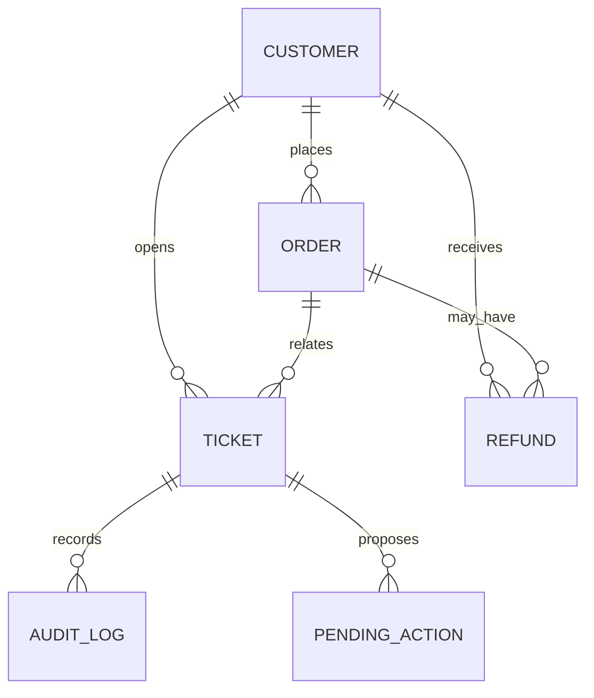

# SupportFlow AI

**Investigate. Reason. Recommend. Act — with Human Approval.**

SupportFlow AI is an agentic customer-support copilot. A support executive describes a case in natural language. The system investigates with **allowlisted tools**, retrieves **fictional company policies** with RAG, applies **configurable business rules**, and proposes a resolution. Sensitive operations such as refunds never execute until a human approves them.

## Problem statement

Support work usually means hopping across customer, order, ticket, and policy systems. That is slow and easy to get wrong. Blindly letting an LLM write SQL or issue refunds is worse.

## Solution

```text
User → AI Agent → Tool → Backend/API → Database
```

The LLM never touches the database. It can only call tools. Refunds are created as `PENDING_APPROVAL`. Approving in the UI runs validation, simulated processing, ticket update, and an audit log.

## Features

- Multi-step tool-calling agent (LangChain + Groq Llama)
- RAG over local policy PDFs (HuggingFace embeddings + ChromaDB)
- Human-in-the-loop refunds and escalations
- Customers, orders, tickets, refunds, analytics, audit trail
- Session memory (customer/order/ticket context) with live re-fetch
- Streamlit console + FastAPI
- SQLite by default, PostgreSQL optional
- Offline evaluation harness (no fabricated scores)

## Architecture

```text
                         ┌──────────────────────┐
                         │      SUPPORT AGENT   │
                         │   LLM + LangChain    │
                         └──────────┬───────────┘
                                    │
             ┌──────────────────────┼──────────────────────┐
             ▼                      ▼                      ▼
      Business tools            RAG tool             Analytics
             │                      │
             ▼                      ▼
       SQLAlchemy ORM            ChromaDB
             │                      │
       Customers/Orders         Policy PDFs
       Tickets/Refunds
             │
             ▼
      Resolution engine + Human approval + Audit log
```

### Agent architecture

1. Understand the executive's request  
2. Select allowlisted tools  
3. Observe tool JSON (facts only)  
4. Retrieve policy chunks when needed  
5. Apply `backend/rules/business_rules.py` via tools  
6. Recommend an action  
7. Create pending approval for sensitive work  
8. After human approval, execute and log  

`approve_refund` / `process_refund` are **not** registered on the agent. Only the approval API can process a refund.

### Tool architecture

Tools in `backend/tools/registry.py` wrap services. Services use SQLAlchemy. The agent cannot emit SQL or Python.

### RAG pipeline

```text
PDF → load → split → metadata (document, page, policy_type, chunk_id)
    → embeddings (all-MiniLM-L6-v2) → Chroma persist → top_k retrieve
```

Policies belong to fictional **Northwind Commerce**. They are not copied from real companies.

## Database schema (ER)



## Tech stack

| Layer | Choice |
| --- | --- |
| UI | Streamlit, Plotly |
| API | FastAPI, Pydantic |
| ORM | SQLAlchemy |
| Agent | LangChain, Groq Llama |
| RAG | HuggingFace embeddings, ChromaDB, pypdf |
| Data | Pandas, NumPy |
| DB | SQLite (default) or PostgreSQL |

## Installation

```bash
git clone <repository>
cd supportflow-ai
python -m venv venv
```

Windows:

```bash
venv\Scripts\activate
```

macOS / Linux:

```bash
source venv/bin/activate
```

```bash
pip install -r requirements.txt
copy .env.example .env   # Windows: copy  |  Unix: cp .env.example .env
```

Set `GROQ_API_KEY` in `.env`. Never commit `.env`.

Generate policy PDFs and seed data (also happens on API startup):

```bash
python scripts/generate_knowledge_base.py
python scripts/seed.py
```

## Environment variables

| Variable | Purpose |
| --- | --- |
| `GROQ_API_KEY` | Groq API key |
| `GROQ_MODEL` | e.g. `llama-3.3-70b-versatile` |
| `DATABASE_URL` | `sqlite:///./data/supportflow.db` or Postgres URL |
| `CHROMA_PERSIST_DIRECTORY` | Local Chroma folder |
| `EMBEDDING_MODEL` | Default `sentence-transformers/all-MiniLM-L6-v2` |
| `RAG_TOP_K` | Default `4` |
| `API_BASE_URL` | Streamlit → API, default `http://127.0.0.1:8000` |

## Running the project

From the `supportflow-ai` directory:

```bash
uvicorn backend.main:app --reload
```

In a second terminal:

```bash
streamlit run frontend/app.py
```

Open the Streamlit URL. Demo login:

- Email: `exec@supportflow.local`
- Password: `demo123`

API docs: `http://127.0.0.1:8000/docs`

First API start downloads the embedding model and indexes PDFs. That can take a few minutes.

## Example queries

- Where is order ORD1001?
- Customer CUST001 says their order is late. Investigate.
- Is customer CUST001 eligible for a refund?
- Create a refund request for the eligible order ORD1001 and ticket TKT1023.
- Refund this ₹80,000 order ORD8801.
- What is the company's refund policy for delayed shipments?
- Check customer CUST001's last three orders and tell me whether there are any unresolved issues.

Demo data: **CUST001 / Rahul Sharma / ORD1001** (delayed, ₹2,499), **ORD8801** (₹80,000 high-value), **TKT1023**.

## Evaluation

```bash
python eval/run_eval.py
pytest
```

`eval/run_eval.py` writes `eval/last_results.json` from **real** retrieval and rule checks. It does not invent percentages. The Analytics page shows that file when present.

Offline metrics:

- Tool allowlist coverage for 20 eval questions  
- Policy document hit-rate via Chroma  
- Groundedness = retrieved context is non-empty when sources exist  
- Action recommendation on ORD1001 (eligible) vs ORD8801 (escalate)  
- Approval compliance (process/approve tools absent from the agent)

Live LLM tool-selection quality depends on Groq and is not scored unless you run the agent yourself.

## Tests

```bash
pytest tests/test_tools.py tests/test_api.py tests/test_agent.py tests/test_rag.py
```

Coverage includes valid/invalid orders, eligible/ineligible/high-value/duplicate refunds, approval rejection, and RAG document hits.

## API

- `POST /api/chat` and `POST /api/agent/investigate`
- `GET /api/customers`, `GET /api/customers/{id}`
- `GET /api/orders`, `GET /api/orders/{id}`
- `GET/POST/PUT /api/tickets`
- `GET /api/approvals`, `POST /api/approvals/{id}/approve|reject`
- `POST /api/refunds`, `GET /api/refunds/{id}`
- `POST /api/knowledge/upload`, `GET /api/knowledge/documents`
- `GET /api/analytics`, `GET /api/audit`

## Limitations

- Refunds are simulated; there is no payment gateway  
- Authentication is a demo login, not SSO  
- Embeddings download on first run  
- LLM quality depends on Groq availability and the chosen model  
- Memory is in-process (lost on restart)

## Future improvements

- Persist conversation memory in the database  
- Stronger RAG evaluation with labeled chunk IDs  
- Outbound email drafts (still no real customer mail)  
- Role-based approval limits  

## Safety

No hard-coded API keys, no LLM SQL, no direct DB access from the model, no arbitrary Python execution, no automatic high-risk refunds. Tools are allowlisted. Inputs are validated with Pydantic. Approvals and audit logs are mandatory for sensitive actions.
